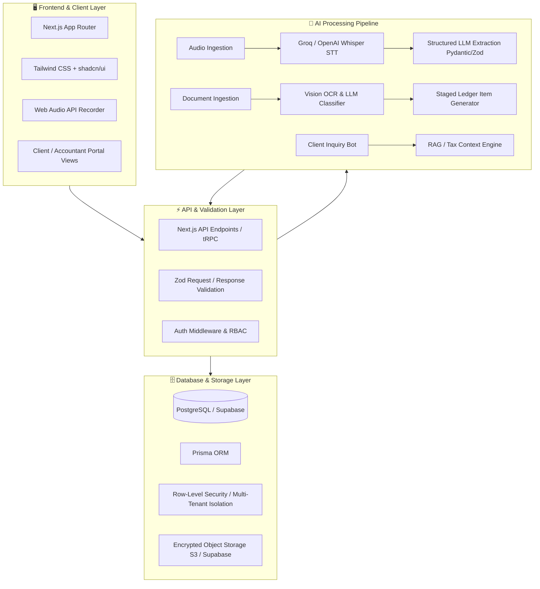
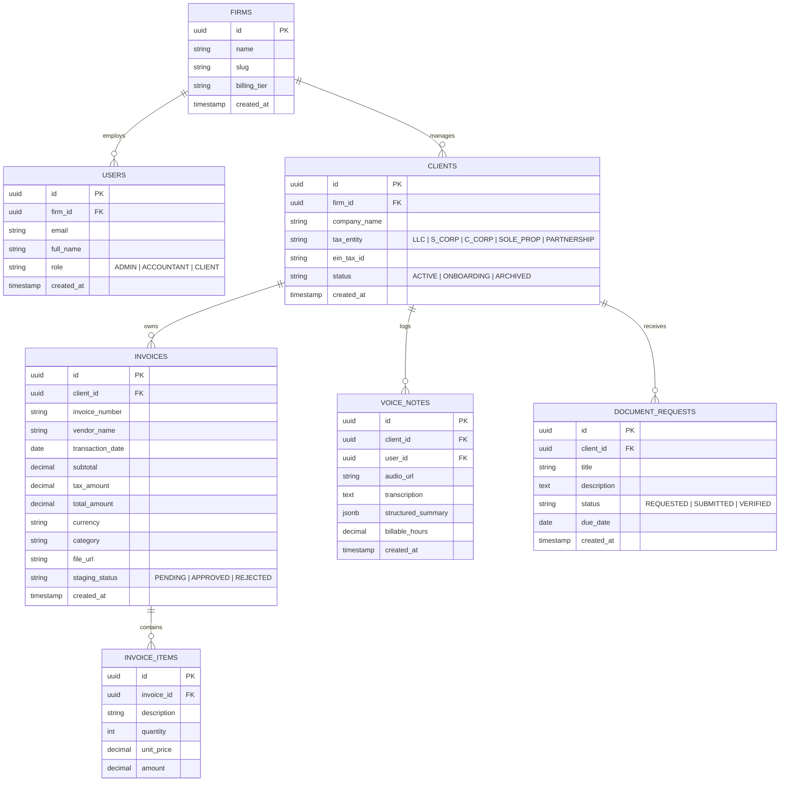

<div align="center">

# 📊 LedgerPilot

**AI-Native Client Portal, CRM & Automated Bookkeeping Suite for CPAs and Modern Accounting Firms**

[](https://nextjs.org/)
[](https://www.typescriptlang.org/)
[](https://tailwindcss.com/)
[](https://ui.shadcn.com/)
[](https://www.postgresql.org/)
[](https://www.prisma.io/)
[](LICENSE)

<p align="center">
  <a href="#-executive-summary">Executive Summary</a> •
  <a href="#-dual-horizon-product-vision">Product Vision</a> •
  <a href="#-system-architecture">Architecture</a> •
  <a href="#-core-modules-phase-1">Core Modules</a> •
  <a href="#-database-schema--erd">Database ERD</a> •
  <a href="#-getting-started">Getting Started</a> •
  <a href="#-security--compliance">Security</a>
</p>

---

</div>

## 📌 Executive Summary

Modern CPAs, bookkeepers, and accounting firms spend over **35% of their working hours** chasing clients for missing receipts, manually transcribing handwritten or PDF invoices, deciphering unstructured voice updates, and fielding routine tax inquiries.

**LedgerPilot** is an enterprise-ready, AI-native FinTech platform engineered to automate the messy operational workflows of accounting practices. Built with a schema-first multi-tier architecture, LedgerPilot bridges the gap between client communication, document ingestion, and general ledger preparation.

---

## 🚀 Dual-Horizon Product Vision

LedgerPilot is structured in two distinct developmental horizons:

```mermaid
timeline
    title LedgerPilot Developmental Horizons
    section Horizon 1: Semester MVP
        Multi-tier Auth & Role Separation : Firm & Client Portal Views
        AI Document Parser : Drag & Drop OCR for Invoices & Receipts
        Voice-to-Ledger Engine : Browser Audio to Structured Audit Notes
        Client Interaction Widget : Tax Q&A & Document Request Portal
        Normalized PostgreSQL Schema : Foundation with Strict RLS
    section Horizon 2: Commercial Scale
        Accounting Integrations : Two-way sync with QuickBooks & Xero
        Automated Bank Reconciliation : Anomaly & fraud flagging
        White-Label Portals : Custom domain & branding (portal.firm.com)
        Automated Document Chasing : Multi-channel SMS/Email reminders
        Stripe Enterprise Billing : Subscription & usage-based metering
```

### 1. Phase 1 (Immediate Scope — Semester MVP)
- **Multi-Role Authentication & Core CRM**: Dedicated views for Firm/Staff vs. Business Clients. Client profile tracking (Tax Entity types: LLC, S-Corp, C-Corp, Sole Prop, EIN, Deadlines).
- **AI Document Extraction Engine**: Drag-and-drop OCR and vision-based parsing for PDFs, PNGs, and JPGs. Extracts vendor, date, currency, subtotal, tax, line items, and auto-categorizes expenses.
- **Editable Staging Workflow**: "Human-in-the-loop" approval table before committing entries to permanent ledger records.
- **Voice-to-Ledger Audit Memos**: In-browser audio capture transcribed via high-speed Whisper/Groq API and transformed by LLM structured outputs into categorized client notes, action items, and billable hour logs.
- **Client Support & Document Ingestion Widget**: Context-bounded assistant providing tax guidance and direct file submission.

### 2. Phase 2 (Commercial Roadmap)
- Two-way synchronization with QuickBooks Online (QBO) and Xero REST APIs.
- Multi-tenancy with subdomain isolation and custom firm branding (`portal.firmname.com`).
- Automated intelligent document chasing with scheduled reminders.
- Bank statement CSV/OFX automated reconciliation with fraud/anomaly detection.
- Stripe subscription billing and usage meters.

---

## 🏛️ System Architecture

LedgerPilot employs a modern, decoupled full-stack architecture designed for high throughput, type safety, and seamless horizontal scaling:



---

## 🗃️ Database Schema & ERD

The database is fully normalized to 3NF, ensuring data integrity, strict referential actions, and forward compatibility for multi-tenant SaaS scaling without schema redesign:



---

## 🛠️ Technology Stack

| Layer | Technology | Justification |
| :--- | :--- | :--- |
| **Framework** | **Next.js 15+ (App Router)** | Hybrid SSR/CSR, zero-waterfall server components, and native API routes. |
| **Language** | **TypeScript 5.x** | End-to-end type safety across backend schemas, API responses, and UI props. |
| **Styling & UI** | **Tailwind CSS + shadcn/ui** | Accessible, headless primitives styled with high-density enterprise typography. |
| **Database** | **PostgreSQL (Supabase)** | Enterprise ACID compliance, native JSONB support, and Row-Level Security. |
| **ORM** | **Prisma** | Declarative schema definitions, type-safe query generation, and automated migrations. |
| **Validation** | **Zod** | Runtime contract validation for API routes and structured LLM tool outputs. |
| **Speech-to-Text** | **Groq (Whisper-large-v3)** | Sub-second audio transcription throughput for near-instant memo parsing. |
| **Document AI** | **OpenAI Vision / GPT-4o** | High-accuracy zero-shot extraction of noisy physical receipts and digital invoices. |

---

## 💻 Getting Started

### Prerequisites
- **Node.js**: `v20.x` or `v24.x` (LTS recommended)
- **Package Manager**: `npm` (v10+)
- **PostgreSQL Database**: Local instance or free [Supabase](https://supabase.com) project
- **API Keys**: OpenAI and Groq accounts

### Installation & Setup

1. **Clone the Repository**
   ```bash
   git clone https://github.com/hash2Me/LedgerPilot.git
   cd LedgerPilot
   ```

2. **Install Dependencies**
   ```bash
   npm install
   ```

3. **Configure Environment Variables**
   ```bash
   cp .env.example .env.local
   ```
   Open `.env.local` and configure your `DATABASE_URL`, `OPENAI_API_KEY`, and `GROQ_API_KEY`.

4. **Initialize Database & Run Migrations**
   ```bash
   npx prisma migrate dev --name init
   npx prisma generate
   ```

5. **Start Development Server**
   ```bash
   npm run dev
   ```
   Navigate to [http://localhost:3000](http://localhost:3000) to view the application.

---

## 🔒 Security, PII & Compliance

Financial documents handle highly sensitive Personally Identifiable Information (PII) including Employer Identification Numbers (EIN), Social Security Numbers (SSN), and banking details:

1. **Row-Level Security (RLS)**: Every database query enforces strict multi-tenant tenancy boundaries keyed on `firm_id` and `client_id`.
2. **Encrypted Storage**: Documents stored in object storage utilize AES-256 server-side encryption with time-limited signed URLs.
3. **Data Sanitization**: PII fields are sanitized and masked before being dispatched to third-party LLM evaluation prompts.
4. **Audit Trail**: Every invoice approval, modification in the staging table, and note generation records an immutable audit log.

---

## 🗺️ Project Roadmap

- [x] Repository initialization & architecture specification
- [ ] Database schema finalization (`schema.prisma`) & migrations
- [ ] Authentication system & multi-role layout (Firm Staff vs. Client)
- [ ] AI Invoice & Receipt upload dropzone with staging review table
- [ ] In-browser audio recorder with Groq Whisper & LLM action item extractor
- [ ] Client document portal & interactive tax FAQ assistant
- [ ] Phase 1 Final Integration & Live Showcase Demo

---

## 👥 Contributors & Maintainers

- **Usman** ([@hash2Me](https://github.com/hash2Me)) — Lead Full-Stack Architect & Technical Co-Founder

---

## 📄 License

This project is licensed under the MIT License — see the [LICENSE](LICENSE) file for details.
